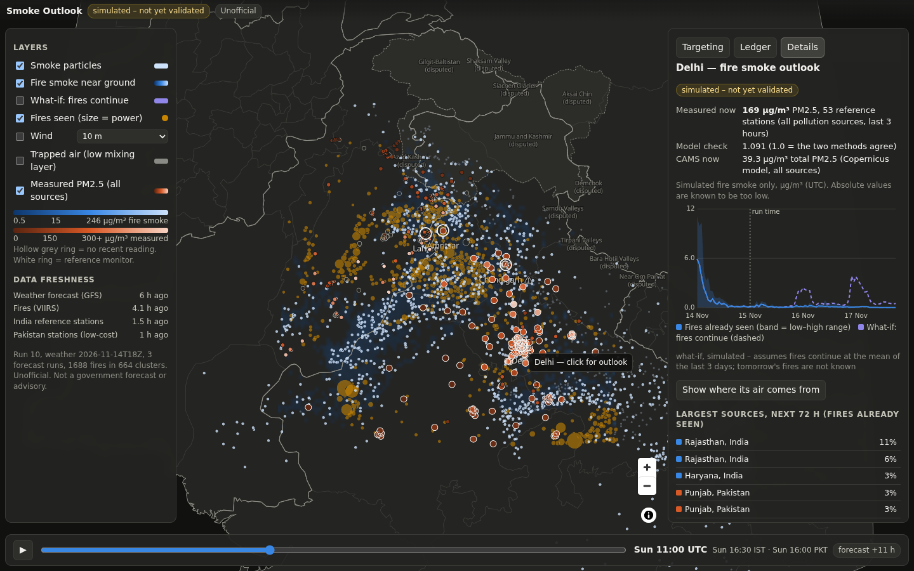
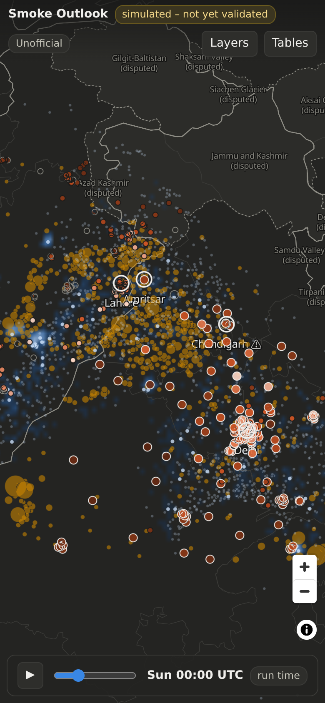

# Smoke & GRAP Outlook (India)

Simulates where smoke from real fires goes over 72 hours using real forecast weather.
Outputs are simulated and unofficial. Spec: `docs/SPEC.md`. Status: `PROGRESS.md`.

## Quick start

```bash
cp .env.example .env        # then fill in the keys
uv sync
uv run pre-commit install
docker compose up -d        # Postgres + PostGIS
uv run pytest
```

## The map (Stage 2b)

```bash
uv run uvicorn api.main:app --port 8000    # then open http://localhost:8000
```





Everything shown is simulated. Each city carries its result from the validation below (currently "not reliable here" for all four). Absolute smoke values are known to be too low.

## Validation (Stage 3)

The 2024 and 2025 burning seasons (1 Oct – 30 Nov) were replayed one day at a time, 122 runs, each using only the weather forecast and fires that had been published before the run. Full tables: [`docs/validation.md`](docs/validation.md).

**Re-score (18 Nov 2026), current model** (afternoon fires with the missed-fire factor, 5-day smoke, Lucknow added). Still weak: 0 of 4 cities pass in either season, on the total change or the weather-adjusted target. Best: Amritsar 2024 spike score 0.66 but rise match not clearly above zero; Delhi 2025 rise match 0.19 (90% range -0.04 to 0.38). Chandigarh 2025 rise match is below zero (-0.25). Adding the simulation to "tomorrow = today" changes the error by between 21% worse and 7% better. Simulated smoke is still 7–18× too low for Delhi and Chandigarh. CAMS was not loaded for this run. Full tables: [`docs/validation.md`](docs/validation.md). The earlier tables below are kept for comparison.

**Earlier result (15 Nov 2026, earlier model, three cities): weak. The simulation does not yet tell which days PM2.5 will rise, in any of the three cities.** Receptors are Indian cities only; fires abroad are still simulated as sources. The map says "not reliable here" for all of them.

Scores for the first 24 hours after each run. Rise match = rank correlation between the simulated and the measured day-to-day change (1 = perfect, 0 = none). Spike score = how well a simulated rise picks out the biggest measured rises (1 = perfect, 0.5 = coin toss). "Useful" needed a spike score of 0.65 or more and a rise match clearly above zero; this rule was fixed before the results were seen.

| City | Season | Rise match | Spike score | CAMS spike score | Result |
|---|---|---|---|---|---|
| Delhi | 2024 | -0.04 | 0.48 | 0.51 | not reliable here |
| Delhi | 2025 | 0.17 | 0.58 | 0.57 | not reliable here |
| Chandigarh | 2024 | -0.07 | 0.44 | 0.55 | not reliable here |
| Chandigarh | 2025 | 0.14 | 0.58 | 0.67 | not reliable here |
| Amritsar | 2024 | 0.08 | 0.58 | 0.52 | not reliable here |
| Amritsar | 2025 | -0.15 | 0.36 | 0.68 | not reliable here |

| Region | Season | Rise match | Spike score | Cities useful |
|---|---|---|---|---|
| North (3 cities) | 2024 | -0.01 | 0.50 | 0 of 3 |
| North (3 cities) | 2025 | 0.05 | 0.50 | 0 of 3 |

What else the hindcasts show:
- **Season-long pattern is there.** Simulated smoke is higher on days with higher measured PM2.5 (rank correlation 0.42–0.75). But "tomorrow = today" does better (0.60–0.89), and adding the simulation to it changes the error by between 7% worse and 9% better: no reliable gain.
- **Amounts are far too low.** Simulated fire smoke averages 0.2–1.4 µg/m³ against 60–163 measured. Published DSS (IITM) season shares for Delhi are 15.5% (2024) and 4.9% (2025); ours unscaled is 0.8% in both, so emissions are low by a factor of roughly 6–20 and the model does not reproduce the drop from 2024 to 2025.
- **Ledger shares move.** For the same day, the share of a city's fire smoke from fires in Pakistan changed by 12–26 points (median) between the day-ahead and same-day forecast, and by 36–56 points on the worst tenth of days. The map shows this range next to each city.
- **CAMS** (same-day runs, total PM2.5) is shown for scale; it has an easier job and also misses the 0.65 bar in 4 of 6 city-seasons.
- Shares from fires abroad cannot be checked against stations in the source area, and smoke leaving India is not computed.

The model has fire smoke only, stations measure all pollution, and this model does not replace DSS. Likely causes of the weak result, to work on next: fires lit after the afternoon satellite pass are missed, emissions per fire are too low, and smoke older than 3 days is dropped.

```bash
uv run python -m sim.hindcast fetch 2024        # archive forecasts + fires (about 20 GB download per season)
uv run python -m sim.hindcast run 2024          # 61 daily runs, about 1¼ hours on 5 cores
uv run python -m ingest.openaq_archive 2024 2025 && uv run python -m ingest.xkdr_archive 2024
uv run python -m spark_jobs.station_archive     # needs Java 17+
uv run python -m sim.validate                   # report + numbers for the map
```

## Live inputs (Stage 1)

```bash
uv run python -m ingest.run      # GFS, FIRMS, stations, CAMS, boundaries -> Postgres
uv run python -m ingest.status   # rows, newest timestamp, STALE flags per source
```

The first ingest downloads about 3 GB of weather (10 min); later runs take seconds unless a new cycle is out.

Then the simulation (Stage 2, about 3.5 min):

```bash
uv run python -m sim.run         # 72 h smoke forecast: grid + cluster-to-city contribution table
```

`uv run python -m sim.fire_forecast` prints the backtest behind the what-if for future fires.

Output is simulated and not yet validated; absolute values are known to be too low (see `PROGRESS.md`).

For ingest, add `--every 60` to repeat hourly. Sources without a key (for example `DATAGOV_API_KEY`) are skipped, not failed.

Optional services: `docker compose --profile kafka up -d`, `docker compose --profile airflow up -d`.
On Windows, keep the repo inside the WSL2 filesystem (not `/mnt/c`).
